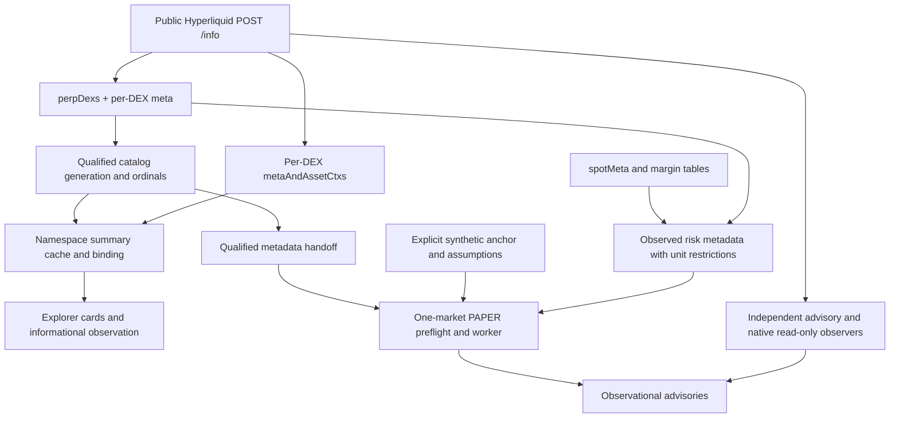
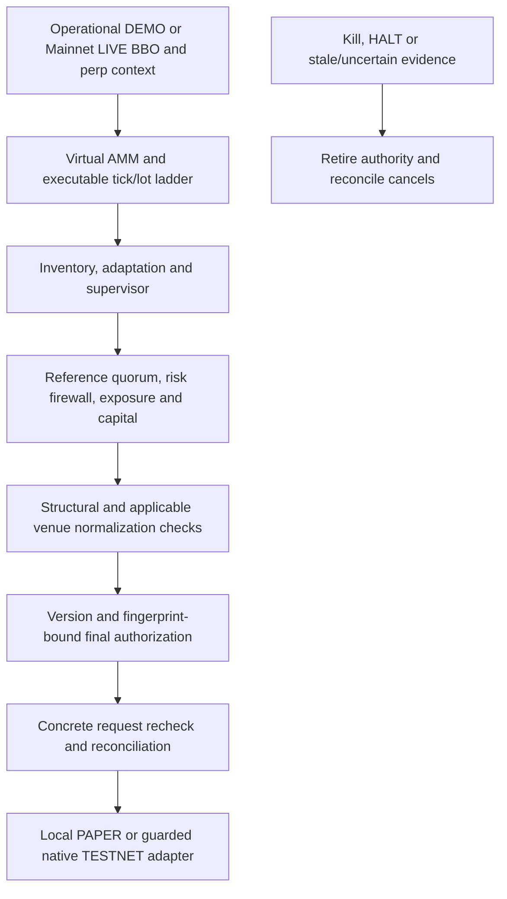

# HyperAMM Audit 4.0 — Independent Phase 18 readiness review

## Decision and audit boundary

**Hold the scoped local release for focused hardening.** Bounded loopback DEMO/PAPER remains usable for controlled research. The public Explorer delivered genuine qualified marks and hourly funding in the observed Mainnet snapshot. The highest-priority findings are the missing operational TESTNET provenance gate, reconciliation that omits venue orders absent from local memory, and completed PAPER results that expire with the input authorization. Sustained delivery remains conditional. The native public observer restarted its whole subscription set while Info calls succeeded. Discovery, summaries, advisory and native calls can contend for the same IP budget.

**Frozen main** `ea1a87321bfd5f22dd375bbc6ca203cc9b41948e`, the [PR #104](https://github.com/btorressz/hyperamm/pull/104) merge. Audit date 2026-11-23 America/Los_Angeles. The supplied checkout was at Phase 16.1A (`7001e070b7094c5fdcde055e3240cfb73c089a6b`). A clean isolated clone used the SHA returned by `git ls-remote origin refs/heads/main`. Pre-Phase 18 source comparison used the first parent of #85 (`14dfde7`), with independent engine compatibility comparisons at #88, #99, #100 and #102. Built and tested with Debian 13.6 x86-64, Python 3.12.14 and Node 24.19.0/npm 11.9.0. See the execution record for resolutions and counts.

The threat model is one trusted OS user with loopback access and locally provisioned data. The audit covered exchanges of normalized public observations, browser and Python contracts, research accounting, fail-closed intent, and local resource ownership. It included actual bounded official Info, Mainnet WebSockets and loopback Linux/Chromium, alongside deterministic fixtures. Signed venue lifecycle, production traffic, remote tenants, real account modes, licensed historical acquisition and other OS/AT combinations are outside the evidence. No wallet, signing, leverage changes, private account operations, or external order execution occurred. No critical defect was identified in the reviewed source and exercised paths. In particular the signed wire path was inspected and exercised only through existing unsigned fixtures.

### Capability matrix

| Layer | Status and exact scope | Authority and restrictions |
| --- | --- | --- |
| Operational AMM | **IMPLEMENTED / TESTED WITH FIXTURES.** One free-form operational symbol at a time via `MARKET` or Strategy **Market symbol** and `PUT /strategy`. Both constant product and concentrated liquidity. DEMO uses a generic synthetic feed at the supplied label. Default ETH. Core BTC/ETH/SOL have explicit native *research/observer* contracts, while operational Core selection is string-based. | DEMO/PAPER is supported. LIVE/PAPER needs supported Mainnet Core L2 and perp context, appropriate strategy precision and reference evidence. No complete operational coin allowlist or per-listed-market verification. Core DOGE can be typed and is a conditional candidate with its precision and reference mapping. An arbitrary label that works in DEMO proves no venue capability. |
| Operational transport and order types | **IMPLEMENTED / CONDITIONALLY SUPPORTED.** Operational LIVE subscribes to one coin via SDK on Mainnet and bootstraps with Core `metaAndAssetCtxs` and coin L2. PAPER reconciles simulated limit ladders with local crossing fills. Guarded TESTNET has native-only, post-only `Alo` limit BID/ASK, create/keep/cancel and cancel-then-replace. | TESTNET uses the officially allowed base URL, enabled flag, local credentials, reconciliation, concrete authority and sizing checks. No public API for direct arbitrary order types, leverage changes, custody, Mainnet execution or HIP-3 signing. **SIGNED-VENUE NOT VERIFIED** for every symbol. A4-001 and A4-002 block readiness. |
| Core/HIP-3 Explorer metadata | **IMPLEMENTED / VERIFIED WITH REAL PUBLIC READ-ONLY DATA** for the configured Mainnet point sample. Enumerates the Core and named perpetual DEX namespaces returned by `perpDexs`. Searches source coin, name and DEX, filters instrument type, listing, metadata and research availability, retains delisted records and pages 12 cards. | One server-selected network at a time. The complete generation is limited to 64 namespaces including Core and 4,096 total records. A failed namespace can prevent a fresh complete generation and leave prior metadata stale. Full Testnet currently **UNSUPPORTED at the observed capacity**. Spot, unreturned markets and venue acceptance are outside catalog scope. |
| Explorer public observations | **IMPLEMENTED / VERIFIED WITH REAL PUBLIC READ-ONLY DATA** for eight named Mainnet markets below. A current generation, qualified key, identical namespace universe, position and collateral index bind marks and funding. | One fetch per acquired namespace, 13 keys maximum, selected Details may add one off-page key, three active acquisitions. Missing/delisted rows remain visible with unavailable prices. The entire catalog does not hold current pricing at once. |
| Generalized Standard PAPER | **IMPLEMENTED / CONDITIONALLY SUPPORTED / TESTED WITH FIXTURES**, plus local simulation with actual Mainnet metadata. One qualified current listed Core or HIP-3 instrument per run, explicit synthetic anchor, numeric and scenario feasibility, generation/fingerprint checks and one shared non-queued worker. | No observed mark injection or operational effect. Uses synthetic prices, depth, references, fees, funding and fills. Publicly observed metadata can constrain precision and optional risk. `MARKET_UNIVERSE_NETWORK` controls eligibility. Testnet cases within the cap were fixtures. |
| Asset-aware and risk PAPER | **IMPLEMENTED / TESTED WITH FIXTURES** for both existing AMMs and default, hypothetical and source-constrained risk. Declared controls compile through existing `StrategyConfig`. | `CRYPTO`, `EQUITY`, `INDEX`, `COMMODITY`, `ENERGY`, `FX`, `RATES`, `OTHER`, `UNKNOWN` are operator-declared. Source risk requires additional provable margin policy and compatible units. Family alone changes identity/provenance, never the curve or permissions. |
| Native read-only Live Market Intelligence | **IMPLEMENTED / VERIFIED WITH REAL PUBLIC READ-ONLY DATA** for Core BTC/ETH/SOL, with conditional sustained availability. Separate Mainnet REST, public WebSockets and live history. | L2 exchange timestamp, perp receipt clock, independent SDK and resource owners. DOGE and HIP-3 are unsupported in this native observer even when Explorer prices them. |
| Native Scenario, Replay, Comparison and Portfolio | **IMPLEMENTED / TESTED WITH FIXTURES.** BTC/ETH/SOL native research profiles. Replay uses trusted admitted local datasets, comparisons use qualified source contracts, and portfolio supports any nonempty subset of the three. Sequential isolated legs, hypothetical allocation/reserve and modeled joint alignment and stress. | No arbitrary Core/HIP-3 portfolio, authenticated cross-market correlation, simultaneous operation, live shared capital or cross-DEX netting. Institutional is a display mode with evidence navigation. No compliance or permissions are conferred. |

[Runtime and modes](backend/app/runtime.py#L41) · [Strategy controls](frontend/src/components/StrategyControls.tsx#L64) · [Operational SDK](backend/app/market_data/hyperliquid.py#L145) · [Native profiles](backend/app/simulation/market_profiles.py#L13) · [Execution adapter](backend/app/execution/hyperliquid.py#L319) · [Phase 17 gates](docs/PHASE176_FINAL_ACCEPTANCE.md)

## Phase 18 merge and evidence crosswalk

Compared first-parent deltas (`git diff <merge>^1 <merge>`), changed tests and associated acceptance artifacts. No tracked `CODEOWNERS` file. Owners below are implementation components. Historical totals and claims in those artifacts remain historical. Fresh runs appear in the execution record.

| Merge | Actual changes and current owners | Acceptance evidence and audit disposition |
| --- | --- | --- |
| [#85](https://github.com/btorressz/hyperamm/pull/85) `115f138` | Initial Core/HIP-3 identities, capabilities and provenance in `market_universe_contracts.py`. | [Architecture](docs/PHASE18_0_MARKET_UNIVERSE_ARCHITECTURE.md), initial contract tests. Superseded by stricter v2. |
| [#86](https://github.com/btorressz/hyperamm/pull/86) `ac1bfcf` | Requires network, source coin and canonical ordering, hardens strict flags and nesting. | [18.0B](docs/PHASE18_0B_ACCEPTANCE.md). Current keys separate network, DEX, class and name. |
| [#87](https://github.com/btorressz/hyperamm/pull/87) `8f9e695` | Adds public SDK session transport, discovery owner, route and frontend contract. | [18.1](docs/PHASE18_1_DISCOVERY_ACCEPTANCE.md). Actual Mainnet and Testnet inventory observations, only Mainnet published. |
| [#88](https://github.com/btorressz/hyperamm/pull/88) `b2163b5` | Adds qualified PAPER profiles, scenarios and isolated worker route. | [18.2](docs/PHASE18_2_PAPER_ACCEPTANCE.md). Current 120-frame ceiling and typed rejecting preflight, A4-005. |
| [#89](https://github.com/btorressz/hyperamm/pull/89) `4d57eaf` | Binds admission to fresh generation, strengthens synthetic references and worker entry. | [18.2G](docs/PHASE18_2G_FINAL_HARDENING_ACCEPTANCE.md). Native digest reproduced. |
| [#90](https://github.com/btorressz/hyperamm/pull/90) `3752b71` | Financial unit, collateral, funding, account and margin evidence types in `market_risk_contracts.py`. | [Architecture](docs/PHASE18_3_MARKET_RISK_ARCHITECTURE.md). Model contracts provide no venue permission. |
| [#91](https://github.com/btorressz/hyperamm/pull/91) `27713d0` | Adds public collateral/tier normalization, isolated risk math and generalized PAPER firewall wiring. | [18.3B–D](docs/PHASE18_3BCD_RISK_IMPLEMENTATION_ACCEPTANCE.md). Current-source limits and financial oracle checked. |
| [#92](https://github.com/btorressz/hyperamm/pull/92) `bb07f71` | Adds risk-evidence endpoint and PAPER risk inputs UI, narrows quote/collateral compatibility. | [18.3E–F](docs/PHASE18_3_FINAL_ACCEPTANCE.md). Source constraint is stricter than metadata discovery. |
| [#93](https://github.com/btorressz/hyperamm/pull/93) `f7cc7e7` | Adds immutable observational agent contracts and source identities. | [Architecture](docs/PHASE18_4_ADVISORY_ARCHITECTURE.md). Authority flags remain false/NONE. |
| [#94](https://github.com/btorressz/hyperamm/pull/94) `d434129` | Adds Market Eligibility, Funding/Basis, Quote Economics and observation capture. | [18.4B–D](docs/PHASE18_4BCD_AGENTS_ACCEPTANCE.md). Advisory public normalization weaker than Explorer, A4-006. |
| [#95](https://github.com/btorressz/hyperamm/pull/95) `8295ba1` | App-owned advisory coordinator, bounded result receipts, route and validated panels. | [18.4E–F](docs/PHASE18_4_FINAL_ACCEPTANCE.md). Fixture result and fingerprint checks rerun. |
| [#96](https://github.com/btorressz/hyperamm/pull/96) `6325c1e` | Asset classification and controls contracts. | [Architecture](docs/PHASE18_5_ASSET_AMM_ARCHITECTURE.md). Families remain declarations, no automatic numerical remapping. |
| [#97](https://github.com/btorressz/hyperamm/pull/97) `d6aa1c1` | Maps policy into existing strategy and AMM engine, wraps execution with precision, budget and risk checks. | [18.5B–D](docs/PHASE18_5BCD_ASSET_AMM_ACCEPTANCE.md). Actual final quotes are checked with fixture financial oracles. |
| [#98](https://github.com/btorressz/hyperamm/pull/98) `8b0e77d` | Asset draft and preview endpoint, UI, rejection/state boundaries. | [18.5E–F](docs/PHASE18_5_FINAL_ACCEPTANCE.md). Asset-aware fixed pairs byte-identical across history. |
| [#99](https://github.com/btorressz/hyperamm/pull/99) `1b98041` | Explorer, 13-route integrated shell, Starter/Pro/Institutional, qualified research handoff. | [18.6A–E](docs/PHASE18_6_IMPLEMENTATION_ACCEPTANCE.md). Actual browser and repository fixture harness exercised. |
| [#100](https://github.com/btorressz/hyperamm/pull/100) `06a5b0f` | Bounded namespace market summaries, browser validation, visible revalidation, selected public observation. | [18.6H](docs/PHASE18_6_HARDENING_ACCEPTANCE.md). Live field equality checked. Original two aggregate hashes still open. |
| [#101](https://github.com/btorressz/hyperamm/pull/101) `46c7dd3` | Documentation-only current [source map](CODEBASE.md). | Operational and research owners distinct. Correct obsolete Origin and current release wording in § Documentation. |
| [#102](https://github.com/btorressz/hyperamm/pull/102) `4d444b6` | Closes late summary cache/publication on shutdown, adds cross-market/resilience coverage. | [18.7A–C](docs/PHASE18_7ABC_ACCEPTANCE.md). Late/reordered/canceled fixture coverage and short actual cleanup. |
| [#103](https://github.com/btorressz/hyperamm/pull/103) `dd9e148` | Decimal oracle and authority tests, Replay scoped table row groups, browser harness. | [18.7D–E](docs/PHASE18_7DE_ACCEPTANCE.md). Finance rerun and row-group inspection. Browser execution boundaries below. |
| [#104](https://github.com/btorressz/hyperamm/pull/104) `ea1a873` | Test-extra resolution, bounded soak and release documents. No production application module delta. | [Acceptance](docs/PHASE18_7_FINAL_ACCEPTANCE.md) · [Runbook](docs/PHASE18_RELEASE_RUNBOOK.md). Separate fresh tests and 105-second soak below. |

Phase 17 first-parent review covered [#73](https://github.com/btorressz/hyperamm/pull/73) allocation and provenance contracts, [#74](https://github.com/btorressz/hyperamm/pull/74) native resolution/acceptance, [#75](https://github.com/btorressz/hyperamm/pull/75) isolated multi-market PAPER, [#76](https://github.com/btorressz/hyperamm/pull/76) shared *modeled* capital and exposure, [#77](https://github.com/btorressz/hyperamm/pull/77) temporal binding, [#78](https://github.com/btorressz/hyperamm/pull/78) stress, [#79](https://github.com/btorressz/hyperamm/pull/79) preview/terminal composition and [#80](https://github.com/btorressz/hyperamm/pull/80) precision/resources/final acceptance. Audit 3 lineage [#81](https://github.com/btorressz/hyperamm/pull/81) through [#84](https://github.com/btorressz/hyperamm/pull/84) supplied earlier risk, SDK, accessibility and dependency counterexamples. The current guarded adapter remains native-only, with no production adapter or permission expansion in Phase 18. Source changes versus the pre-Phase 18 tree are concentrated in discovery, research and UI. Runtime/execution boundaries reviewed below predate Phase 18. [Phase 17 evidence](docs/acceptance/phase176) · [Audit 3 remediation](docs/AUDIT3_FINAL_REMEDIATION_ACCEPTANCE.md)

## Public market snapshot and flow

The real application discovery and summary owners ran against official endpoints over the existing public transport with a FastAPI ASGI client. Mainnet `POST /info` used `perpDexs`, one `meta` per namespace, `spotMeta` and one `metaAndAssetCtxs` for each of Core, xyz and io. Sixteen successful calls. Fetched 2026-11-23 11:40:45–48 PST (19:40:45–48 UTC). Catalog HTTP 200, fingerprint `2b16c3cb3d60eb4b8d68c58c1ffc687f2f6c5f49103bd9a22bde7323ded472d8`. Of 570 records, 354 were listed and 216 were provider-delisted. Counts below are specific to that returned inventory.

| DEX | Listed | Delisted | Price check |
| --- | ---: | ---: | --- |
| Core | 179 | 56 | BTC, ETH, SOL, DOGE. Core AI explicitly unsupported. |
| abcd | 0 | 1 | No listed contracts in this snapshot. |
| cash | 0 | 17 | No listed contracts in this snapshot. |
| flx | 0 | 16 | No listed contracts in this snapshot. |
| hyna | 0 | 25 | No listed contracts in this snapshot. |
| io | 18 | 8 | io:AAPL observed. |
| km | 0 | 23 | No listed contracts in this snapshot. |
| mkts | 1 | 23 | Discoverable. Mark/funding NOT RUN. |
| para | 33 | 7 | Discoverable. Mark/funding NOT RUN. |
| vntl | 0 | 15 | No listed contracts in this snapshot. |
| xyz | 123 | 25 | xyz:GOLD, xyz:XYZ100, xyz:AAOI observed. |

All listed sample rows were `EXCHANGE_VERIFIED` for listing metadata and `CURRENT` within the receipt window. The actual summary showed raw `markPx` as `mark_price` and raw `funding` as `funding_rate`. The table retains the raw funding fraction and the rendered percent/hour. All eight also had valid `prevDayPx`, `dayNtlVlm` and `openInterest`. Core receipt 11:40:48.030308 PST, xyz .152238 and io .071256. All expired at their respective receipt plus 30 seconds. `provider_event_at` was null. Rows are qualified by Hyperliquid, network, DEX, class and source coin.

| Network / class / DEX | Coin | Size decimals | Mark | Funding fraction → %/hour | Research / operations / signing |
| --- | --- | ---: | ---: | --- | --- |
| Mainnet Core / empty | BTC | 5 | 61,037.0 | 0.0000125 → 0.00125% | Generalized check required. Native profile and observer. Operational Core candidate. Signed NOT RUN. |
| Mainnet Core / empty | ETH | 4 | 1,723.8 | 0.0000039345 → 0.00039345% | Generalized check required. Default operational DEMO symbol, native profile and observer. Signed NOT RUN. |
| Mainnet Core / empty | SOL | 2 | 72.578 | 0.0000039573 → 0.00039573% | Generalized check required. Native profile and observer. Operational Core candidate. Signed NOT RUN. |
| Mainnet Core / empty | DOGE | 0 | 0.056548 | −0.0000050084 → −0.00050084% | Generalized check required. No native research profile/observer. Free-form Core operational candidate only. Signed NOT RUN. |
| Mainnet HIP-3 / xyz | xyz:GOLD | 4 | 3,642.3 | 0.00000625 → 0.000625% | Generalized check required. No supported operational or signed route. |
| Mainnet HIP-3 / xyz | xyz:XYZ100 | 4 | 26,684.0 | 0.00000625 → 0.000625% | Generalized check required. No supported operational or signed route. |
| Mainnet HIP-3 / xyz | xyz:AAOI | 2 | 38.088 | 0.0000203019 → 0.00203019% | Generalized check required. No supported operational or signed route. |
| Mainnet HIP-3 / io | io:AAPL | 3 | 349.96 | −0.000005276 → −0.0005276% | Generalized check required. No supported operational or signed route. |
| Mainnet Core / empty | AI | 1 | Unavailable | Unavailable | Delisted, summary UNSUPPORTED. No current research or operational admission evidence. |
| Testnet Core / empty | BTC, ETH, SOL, DOGE | Catalog unavailable | Direct only | Direct only | Inventory 288 including Core. HTTP 503 with inventory CATALOG_CAPACITY, no published catalog or generalized PAPER. Signed NOT RUN. |

A separate single direct Testnet Core Info call observed BTC 60,832 / 0.0000125, ETH 1,724.1 / 0.0000125, SOL 72.25 / −0.0000271712 and DOGE 0.056499 / 0.0000125 (mark / raw funding). Testnet inventory and direct context were the only two Testnet calls. These values can establish upstream availability for those fields only. Production-build Chromium independently displayed Core BTC/DOGE and xyz:GOLD/XYZ100 and io:AAPL with **Mark price**, **Funding / hour**, **vs. previous-day ref.**, **24h notional volume** and **Open interest · base**. Its separate BTC receipt displayed 60,974 and 0.00125%/hour. The presence of a priced card indicates no ability to trade. [Public contract](https://hyperliquid.gitbook.io/hyperliquid-docs/for-developers/api/info-endpoint/perpetuals) · [Adapter and parser](backend/app/market_data/market_universe_discovery.py#L138) · [UI fields](frontend/src/components/markets/MarketExplorer.tsx#L215)





[Release API map](docs/PHASE18_7_ACCEPTANCE_MATRIX.md) · [Runtime authorization](backend/app/runtime.py#L257) · [Summary owner](backend/app/market_data/market_summaries.py#L194)

### Eligibility against the sampled Mainnet metadata

A separate real local DEMO/PAPER lifespan accepted all eight 12-frame QUIET proposals at these independently chosen synthetic anchors: BTC 60000, ETH 1700, SOL 70, DOGE 0.05, xyz:GOLD 3500, xyz:XYZ100 25000, xyz:AAOI 40 and io:AAPL 300. DOGE and xyz:GOLD completed on the actual local worker, both HTTP 200 with `execution_mode=PAPER` and `simulated=true`. The six other cases checked admission only. The risk-evidence endpoint returned source-observed eligibility for `xyz:AAOI` and `io:AAPL` with modeled ISOLATED and NO_CROSS options. BTC/ETH/SOL/DOGE, GOLD and XYZ100 returned UNAVAILABLE with `RISK_MARGIN_MODE_UNSUPPORTED`. Source-constrained execution against current live metadata was NOT RUN. The asset-aware controlled executions used fixtures. Public observations were never used as the chosen research inputs. [Admission API](backend/app/api/market_universe.py#L322) · [Risk policy](backend/app/risk/market_risk_engine.py#L139)

## Numbered audit answers

### Market data, pricing and reliability

| Question | Independent answer and evidence |
| --- | --- |
| Q01 · Price provenance | Explorer, Dashboard's public panel and qualified PAPER observation use Info `markPx`, and Details displays `oraclePx` and `prevDayPx`. The large operational header value is unlabeled L2 BBO midpoint. Operational Markets labels BBO, midpoint, perp mark/oracle and consensus separately. Strategy reference is a derived weighted/adapted anchor. Native Live Intelligence labels L2 BBO and its midpoint separately from `metaAndAssetCtxs` or `activeAssetCtx` mark, oracle and optional `midPx`. Replay uses admitted recorded fields and separate simulated quote/fill prices. Portfolio and generalized research use generated prices and modeled P&L. No last-trade price is used in the Explorer. [Header](frontend/src/components/Header.tsx#L49) · [Markets](frontend/src/pages/Markets.tsx#L43) · [Public summary](backend/app/market_data/market_summaries.py#L102) |
| Q02 · Qualified context | The sampled eight rows agreed field-for-field with the same raw response. Summary checks network, DEX, ordinal, listing, precision, full namespace order, optional context identifiers and collateral index before passing any values. API and client recheck catalog and metadata bindings. Distinguish native read-only observers and funding advisory normalizers, which have different validation rules. [Summary](backend/app/market_data/market_summaries.py#L153) · [Frontend validator](frontend/src/utils/marketSummaries.ts#L84) |
| Q03 · Units and missing data | Mark is provider quote/base, volume provider notional, OI base and hourly funding a fraction multiplied by 100 for percent. Mark/oracle and prior reference nulls stay unavailable. A genuine reported zero survives for funding, volume and OI. A row with only one valid metric is CURRENT, and individual missing fields stay unavailable. Only selected Details exposes the source limitations. Native/operational OI notional is derived as mark × base OI. Native “Raw venue funding rate” is formatted as a percentage and omits the interval. A4-006 covers the public advisory bound mismatch. [Fields](backend/app/market_data/market_summaries.py#L102) · [Native metrics](frontend/src/components/markets/LivePerpMetrics.tsx#L4) · [Official funding](https://hyperliquid.gitbook.io/hyperliquid-docs/trading/funding) |
| Q04 · Prior-day and basis | `100 × (markPx − prevDayPx) / prevDayPx`, with eight decimal places and a conservative-ceiling Decimal context. Card labels the previous-day reference. Explorer explicitly withholds compatible denomination/basis claims even with matching collateral index. The advisory has a weaker denomination check. Native Core basis uses same-context inputs, with mark/mid and oracle/mid withheld if provider mid is absent. [Summary math](backend/app/market_data/market_summaries.py#L112) · [Details](frontend/src/components/markets/MarketExplorer.tsx#L175) · [Advisory basis](backend/app/agents/funding_basis.py#L153) |
| Q05 · Clock semantics | Official asset contexts supply no verified event clock for these values. Summary explicitly returns `LOCAL_RECEIPT` and null `provider_event_at`. Browser Details says “Server receipt time” and “Provider event time Unavailable”. Live L2 separately uses its exchange time, while the native WS perp context uses receipt. [Summary contract](backend/app/market_data/market_summaries.py#L58) · [Native stream](backend/app/market_data/live_streams.py#L385) |
| Q06 · Expiry and cache | Summary valid while `observed ≤ now < min(observed + 30 s, generation deadline)`. Frontend uses wall clock and monotonic time from request start, whichever expires first, plus interval/expiry/visibility events. Passing fixtures observed expiry exactly at the server deadline and hidden marks at client expiry and delayed cross-scope fetch. Catalog handoff and PAPER deadlines use browser wall clock, so skew can temporarily disagree with the server and lead to a stale/rejected control. Server binding remains authoritative. Generalized completed evidence and operational disconnected rendering have distinct defects. [Summary hook](frontend/src/hooks/useMarketSummaries.ts#L7) · [Catalog deadline](frontend/src/utils/marketUniverse.ts#L150) · [PAPER lifecycle](frontend/src/components/simulation/GeneralizedPaper.tsx#L128) |
| Q07 · Wrong-market publication | Same-name fixtures across network/DEX, changed ordinals, dead generation, missing/shortened context and namespace conflicts rejected in focused tests. The client scope key includes network, generation, market key, precision-bound metadata fingerprint and index. Actual Mainnet search returned Core BTC beside delisted named BTC rows without merging identity. Positional exchange contract remains a trust dependency when context rows have no coin. No way to detect a simultaneous silent context-only swap from supported fields. [Cross-market tests](backend/tests/test_phase187_market_regression.py) · [Summary validation](backend/app/market_data/market_summaries.py#L157) |
| Q08 · Availability UX | Delisted metadata remains searchable and unsupported for pricing/PAPER. Missing, stale, capacity, timeout and throttle are distinguishable on Explorer cards. Metadata-only and partial captures may lack one or all values. Selected public PAPER panel collapses most specific reasons into Unavailable, while off-page Details omit mark and funding entirely (A4-009). Inventory capacity details may only appear on the API. [Explorer states](frontend/src/components/markets/MarketExplorer.tsx#L33) · [Selected observation](frontend/src/components/markets/ObservedMarketSummary.tsx) |
| Q09 · Sorting | Text filters and alphabetic ordering cover the catalog. Financial sorts apply after a 12-card slice, descending among current populated values, and visible page/unit limitation is explicit. No globally comparable quote currency is claimed. [Sort](frontend/src/components/markets/MarketExplorer.tsx#L80) |
| Q10 · Batching and concurrency | Fixture verified one cold Info call for 12 same-DEX cards and single flight by generation and DEX. The live eight-record sample needed exactly three context calls. Cache 24, simultaneous 3, reuse 15 s, manual minimum 5 s, collect 6 s, rate backoff 30 s, 24 acquisitions per rolling minute. Disconnect cancels waiter, not shared collection. Retired generation prevented publication and close suppressed late cache insert in fixtures. Current success observed cleanup. [Summary owner](backend/app/market_data/market_summaries.py#L194) · [Focused batching test](backend/tests/test_phase186h_market_summaries.py#L110) |
| Q11 · IP budget | There is no shared governor even though Hyperliquid aggregates REST weight per IP. Local concurrency and store caps limit bursts per owner, with discovery's candidate upper bound alone above the official cap. Significant for extended live use. See A4-004 and call calculations. [Provider limits](https://hyperliquid.gitbook.io/hyperliquid-docs/for-developers/api/rate-limits-and-user-limits) |
| Q12 · Native gap | Historical 30-minute result 36/90 with all three streams fresh and 27 starts. Fresh 105-second run 4/6, 4 SDK starts, 6/6 full summaries. Freshness losses occurred with successful Info calls, with a deliberate first disconnect. Single stale market retires healthy siblings by design of the current loop. Exact per-component historical causes remain unobserved. See A4-003 and the time series below. [Prior soak](docs/acceptance/phase187f/provider-soak.json) · [Current loop](backend/app/market_data/live_streams.py#L561) |
| Q13 · Faults | Public catalog/summary/observed advisory HTTP path rejects non-200, duplicate JSON keys, invalid UTF-8/JSON, nonfinite JSON constants, bodies over 1 MiB and nesting over 32, and nonidentity encoding. The metadata client parses bounded JSON regardless of MIME type. SDK's native paths validate normalized shapes and bounded callback values after SDK decode. Native stream fixtures cover stale/future data, invalid/overflow handling, reconnect and retired generations. Started requests and sockets were drained in the measured owners. Operational SDK callback buffering and private TESTNET teardown differ, A4-008 and A4-011. Browser late-response and stale-state issues below. [Bounded transport](backend/app/market_data/market_universe_discovery.py#L187) · [Resilience tests](backend/tests/test_phase187_provider_resilience.py) |
| Q14 · Testnet scope | Intentional fail-closed cap, immediately rejects 288 inventory rows before any namespace fan-out. Direct Core context works. A future explicit Core/DEX scoped catalog can enforce an allowlist, expose requested/failed/available namespaces, and include a scope/completeness version in the catalog and all bindings. Retain current global caps and no silent partial-as-complete fallback. [Cap logic](backend/app/market_data/market_universe_discovery.py#L237) · [Capacity decision](docs/PHASE18_7ABC_ACCEPTANCE.md#testnet-capacity-decision) |
| Q15 · Observation authority | Explorer and public native observations own distinct services. Historical and generalized execution are isolated, scenario marks/funding come from generated frames, and opt-in risk consumes metadata evidence only. Operational LIVE/PAPER intentionally can use its own live market source and opt-in PAPER funding convention. Generalized scope is blocked from operational references; operational DEMO/TESTNET provenance gap is separate (A4-001). [PAPER routes](backend/app/api/market_universe.py#L322) · [Runtime source separation](backend/app/references/service.py#L91) |

### Financial, AMM, agents and persistence

| Question | Independent answer and evidence |
| --- | --- |
| Q16 · Curve invariant and economics | Constant product samples reserve movement at `sqrt(k/price)`. Concentrated uses the same virtual invariant and reweights incremental liquidity by distance and bounds. Neither allocates actual custody. Tests cover budget/shape, tiny/huge precision, extremes and one-sided feasibility. The focused oracle exercised both curves under default/hypothetical/source-constrained risk. Checks concern normalized quotes and deterministic arithmetic, with no market fill-performance validation. [Curve](backend/app/amm/liquidity_curve.py) · [Finance oracle](backend/tests/test_phase187d_financial_invariants.py) |
| Q17 · Transformed ladder | Quantize with Decimal size down and side-directed prices. Preserve native same-price logical slots with aggregate exposure, retire rounded duplicates in generalized PAPER. Asset-aware adds per-side clamp and explicit minimum order notional. Standard's numeric field is a baseline sizing assumption and its final path lacks the asset-aware floor, so this audit makes no standard minimum-executable-notional claim. Structural checks enforce finite positive levels, global distance, aggregate notional and mutual bid/ask crossing. There is no proven venue minimum order acceptance or final BBO post-only guarantee. Alo rejection remains possible. [Generalized profile](backend/app/simulation/generalized_market_profiles.py#L246) · [Limits](backend/app/risk/limits.py) |
| Q18 · Final request | Normalized native venue price/size before authorization, then exact membership and version/fingerprint checks at reconcile and concrete submit. Revalidates market, side, level, normalized size/price, quote distance, inventory, perp/reference, supervisor, risk and capital. SDK float-to-wire must round-trip exact Decimal economics. Scope/network/receipt presence gaps are A4-001 and A4-002. [Final runtime](backend/app/runtime.py#L257) · [Adapter](backend/app/execution/hyperliquid.py#L116) |
| Q19 · Fail closed and isolation | Manual kill latches before acquiring execution lock, retires authority and requests cancellation. HALT, invalid/stale feeds, missing authority, capital/quote limits and known unknown/cancel states block new local transmission. Already in-flight external effects and unseen orders remain distinct. Detached research routes have no operational execution dependency. Advisory has no signer or update-leverage edge. [Runtime kill](backend/app/runtime.py#L838) · [Research authority tests](backend/tests/test_phase187d_authority_acceptance.py) |
| Q20 · Cash flow and P&L | Average-cost reversal, fees and reservations reconcile in fixture suite and controlled comparison. Realized average-cost cash + fees/funding and signed trade flows with mark agree for modeled equity. Fee events follow fills atomically, funding dedups by effective market interval, latest position and mark; long positive-rate funding is negative. Replay partial fills/lag are separate hypothetical assumptions. Independent sampled-boundary case shows a +1 fill at +11 s charged at +10 s when first context arrived +12 s. This is the documented post-observed-fill sampling convention and is unsuitable for temporal settlement inference. Official real funding uses oracle and interval entitlement. [Paper funding](backend/app/accounting/service.py#L265) · [Convention](docs/ACCOUNTING.md#paper-funding) · [Exchange funding](https://hyperliquid.gitbook.io/hyperliquid-docs/trading/funding) |
| Q21 · Source-constrained risk | Provider token/index, margin policy, tier inference and market provenance are separate from hypothetical quote. Actual `source_margin_modes` point check above. Cross rejected, account mode UNKNOWN, operator supplies compatible valuation where needed. Source tiers do not infer HIP-3 multi-tier denomination. Only same qualified source and fresh fingerprints can constrain modeled risk. Maintenance headroom/stress is research, with no full maintenance engine, offsets, liquidation price or exchange account balance simulation. [Model binding](backend/app/risk/market_risk_engine.py#L139) · [Risk UI](frontend/src/components/simulation/GeneralizedPaperRisk.tsx) |
| Q22 · Nine agent roles | Regime, Toxic Flow, Execution Quality, Liquidity Quality and Perp Crowding adjust conservatively. Predictive Adverse Selection SHADOW is sixth and observational, excluded from authority fingerprint. Market Eligibility, Funding/Basis and Quote Economics are three wholly separate advisories with qualified receipt/model/source and expiry checks. Error-to-neutral supervisor recommendation can relax prior advice within upstream limits. Fixed advisory “confidence” 0.90 on acceptable inputs is a policy score rather than empirical calibration. A4-006 can make that label misleading. [Supervisory contracts](backend/app/agents/README.md) · [Advisory coordinator](backend/app/agents/advisory_coordinator.py#L134) |
| Q23 · Taxonomy and mapping | Operator-declared family with UNKNOWN default. UI labels market identity/precision as exchange supplied and the asset family/controls hypothetical. Family affects provenance, independent of overrides mapping to the existing quote controls. No unasked asset-family recalibration. [Asset policy](backend/app/amm/asset_policy.py) · [UI](frontend/src/components/simulation/GeneralizedPaperAssetPolicy.tsx#L39) |
| Q24 · Research separation | One selected Core/HIP-3 per generalized run, synthetic prices and evaluations, no joint account. Native portfolio accepts only BTC/ETH/SOL, preserves isolated legs, models alignment and aggregation with capital/stress assumptions. Historical segment/dataset identity constraints apply. Portfolio USDC amounts are hypothetical. [Portfolio contracts](backend/app/portfolio_research/models.py) · [Portfolio UI](frontend/src/components/portfolio/PortfolioConfiguration.tsx#L47) |
| Q25 · Financial parity | All 38 standard and 18 asset-aware pairs reproduced at #99, #100, #102 and frozen main with fixed input envelope. Native 39 datasets and three full receipts reproduced between #88 and frozen main. Two original #100 hashes remain unverified historical attestations. Exact hashes and procedure below. [Paper capture](backend/tests/phase187_paper_compatibility.py) · [Native probe](docs/PHASE18_2G_FINAL_HARDENING_ACCEPTANCE.md#native-btcethsol-compatibility) |
| Q26 · Worker lifecycle | One thread, no queue; cancellation of a request leaves possession with the real job. Expiration and fingerprint/current guard before engine start, in-memory job results, optional Redis coordination. Standard path relies on worker for final time guard. No explicit generalized wall-clock kill of a running thread and no idempotency key or durable result resumption across retries/process death. Input expiry can hide a legitimate result, A4-007. Loop-duration work precedes the shared executor, A4-005. [Executor](backend/app/simulation/executor.py) · [Before-run check](backend/app/simulation/generalized_market_profiles.py#L695) · [Redis worker](backend/app/infrastructure/research.py) |

### Security, lifecycle and dependency boundaries

| Question | Independent answer and evidence |
| --- | --- |
| Q27 · Request and archive defenses | Middleware bounds writes at 64 KiB before parsing and rejects ambiguous framing. API/Pydantic bounds and sanitizes validation. Official discovery rejects malformed provider JSON and mismatched identity. Historical import is trusted local provisioning with directory-relative descriptor opens, no-follow/symlink and regular-file/single-link checks, bounded reads, schema/digests and owner-only storage. Content digests do not authenticate exchange origin or licensed acquisition. Public provider and preflight resource weaknesses A4-004/A4-005/A4-008. No external security probing. [Body limit](backend/app/api/research_vault.py#L69) · [Importer](backend/app/research_replay/importers.py) · [Validation](backend/app/research_replay/validation.py) |
| Q28 · Deployment | Loopback peer and parsed Host, same-origin or exact configured local origin, guarded originless browser requests, explicit forwarded-header rejection and one-worker launch checks. Same guard for HTTP and WebSockets. CORS reflects explicit loopback origins with credentials. Uvicorn should run with proxy headers disabled. Local/native clients remain trusted with no identity auth, RBAC or user isolation. Stale UI evidence/controls do not replace backend gates. [Boundary](backend/app/deployment.py#L67) · [Registration](backend/app/main.py#L107) |
| Q29 · Future CI | No workflow change. Treat fork code, dependency lifecycle scripts, test fixtures and artifacts as untrusted. Use PR event, read-only repository contents and no repository/environment secrets or trading egress in required CI. Never run untrusted fork code in a privileged workflow or long-lived self-hosted runner. See sequencing. [GitHub secure use](https://docs.github.com/en/actions/reference/security/secure-use) |
| Q30 · Supply chain | Locked npm install and both advisory checks ran. Vite 7.3.8 and picomatch 4.0.7. GHSA-fc5q-39xc-vjpf was withdrawn 2026-11-18. Accepted pytest range resolved 9.1.1 and pytest-asyncio 1.5.0, outside the affected pytest range. SDK resolved 0.24.0 and supports paths observed here. Python dependencies/build tools use ranges with no transitive hash lock. Scans are point-in-time indexed package checks. [Manifest](backend/pyproject.toml) · [npm lock](frontend/package-lock.json) · [pytest advisory](https://github.com/advisories/GHSA-6w46-j5rx-g56g) · [picomatch advisory](https://github.com/advisories/GHSA-fc5q-39xc-vjpf) |
| Q31 · Lifespan owners | Research jobs drain first, then public streams/REST, native research metadata, advisories, summaries and discovery, runtime and terminal relay, then Redis. Owner close and shield behavior keeps bounded work joined at shutdown. Current mixed probe counted zero owned native SDK sessions/handles/threads/tasks, native local subscribers and fresh components, discovery threads and summary tasks/cache after close. Physical Redis verifies local Pub/Sub and lease lifecycle. Operational callback buffering and guarded TESTNET partial construction/session cleanup need work. [Lifespan](backend/app/main.py#L41) · [Native public owner](backend/app/market_data/live_streams.py#L635) · [TESTNET close](backend/app/execution/hyperliquid.py#L435) |
| Q32 · Restart and Redis | Redis 8.0.2 actual PING, Pub/Sub, Lua admission, lease release, outage/recovery and shutdown verified. It mirrors transient worker/status and terminal activity. Restart recreates process/session ID, kill state, PAPER fill/order/accounting/positions and receipt ownership. Historic local vault files persist. Venue orders live beyond process restart, while current TESTNET reconciliation ignores venue orders without local identity. A4-002 blocks startup recovery. [Redis worker](backend/app/infrastructure/research.py) · [Release runbook](docs/PHASE18_RELEASE_RUNBOOK.md) |
| Q33 · External blockers | Signed native requires explicit operator/test authorization, isolated Testnet account, same-network genuine input/asset gate, authoritative discovery of preexisting orders, wire/cancel/fill and adverse-reconcile evidence, partial fill/fee/order journal and kill persistence. HIP-3/multi-DEX lacks signed IDs, aligned provider/settlement/quote-unit and account policy and tested venue routing. Remote needs identity/RBAC, TLS/proxy trust, tenant/job/data isolation, service quotas and deployment hardening. History needs origin, rights and capture continuity. Native macOS/Windows/AT evidence remains open. [Signed gate](docs/PHASE18_RELEASE_RUNBOOK.md#operator-controlled-signed-testnet-gate) |
| Q34 · Readiness and claims | README's top scope and source-bound disclaimers are substantially accurate. Phase 18.7F open gates stand. “Institutional” is a UI mode with a scoped explanatory banner. Advisory confidence, operational disconnected view and short-lived results weaken precise user interpretation. Docs corrections below. [README](README.md#current-project-status--phase-187f-release-candidate) · [Institutional portfolio](frontend/src/pages/PortfolioResearch.tsx) |

### Browser and accessibility

| Question | Independent answer and evidence |
| --- | --- |
| Q35 · Real Chromium | Used Chromium 151 on the production bundle via loopback and unmodified FastAPI with official Mainnet Explorer data. Inspected Explorer/selected Details and Dashboard, Agents, Risk, Vault, Logs, Portfolio and Simulation views. Actual UI ran a GOLD PAPER scenario with live metadata and separate synthetic price. Actual rendered Starter, Pro, Institutional, qualified asset-aware risk/advisory, Replay and populated portfolio evidence were also inspected with repository provider/history fixtures and real local workers. [Fixture runner](frontend/tests/browser-phase186.py) · [Extended runner](frontend/tests/browser-phase187.py) |
| Q36 · Simulation labeling | Header distinguishes operational DEMO/PAPER, Explorer uses public Info, and selected research presentation explicitly separates public mark/funding from an initially blank synthetic textbox. PAPER fills, equity and fees identify hypothetical quote units. Replay retains historical/source clocks, simulated fill labeling and high-precision values. Local receipt age is visible in cards. Absolute receipt and availability appear in details, but no consistent remaining-validity cue. A4-007/A4-009/A4-010 apply. [Explorer](frontend/src/components/markets/MarketExplorer.tsx) · [PAPER panel](frontend/src/components/simulation/GeneralizedPaper.tsx) |
| Q37 · Modes and navigation | Three modes share 13 canonical routes, six supporting deep links, six supervisory roles and three advisory workspaces. Switching has no backend permission write. Passing base browser check preserved one in-flight PAPER outcome across three modes and Results and verified keyboard mode selection. Completed output vanishes with catalog expiry; mode changes inside current evidence work. Additional 13 × 3 route results are listed in execution. [Navigation](frontend/src/utils/navigation.ts) · [Shell](frontend/src/App.tsx#L62) |
| Q38 · Layout | Fresh 390 px actual Explorer width equaled 390 px document width. Phase 18.6 fixture run covered five viewport sizes, high precision, missing and delisted data and verified actual browser 200% zoom (1,440 to 720 CSS px, DPR 2, document 720). Extended runner captured six layouts including 668 × 390 before its later failure. Automated measurements apply only to inspected panes and data. [Browser harness](frontend/tests/browser-phase186.py#L430) |
| Q39 · Accessibility | Scoped axe runs saw zero violations on the completed scans. Reviewed actual tab focus, modal focus containment/return, horizontal financial table scrolling and contrast samples. Replay asks/bids have two `tbody` groups with explicit `scope=rowgroup` and three column headers. Replay has named series, frame price text/retained book and status region alternatives. Risk and provenance scope labels are present. Automated scanning and inspected DOM establish neither assistive-tech announcements nor complete chart navigation. [Replay book](frontend/src/components/replay/ReplayOrderBook.tsx) · [Replay chart](frontend/src/components/replay/ReplayMarketChart.tsx) |
| Q40 · Disconnect and stale evidence | Explorer survives terminal WS loss and protects query scope; terminal top banner suppresses current prices on loss, and terminal contract checks age, current process/session/sequence and retired IDs. Operational Markets and Risk have divergent disconnected rendering. Controls can remain enabled on retained snapshot (A4-010). PAPER queries use selection/generation and abort guards, no automatic retry. A4-007 loses accepted output. Worker still finishes detached after client loss, browser cannot revive/retrieve it. [Terminal socket](frontend/src/utils/terminalSocket.ts) · [Control actions](frontend/src/components/QuickStrategyControl.tsx#L21) |
| Q41 · Platform availability | Current supported Playwright Firefox and WebKit downloads each returned HTTP 403 Domain forbidden. Browser executions BLOCKED. Native Safari/macOS, Windows, physical mobile, VoiceOver and NVDA NOT RUN. Chromium device-width rendering is desktop Linux evidence. [Prior matrix](docs/acceptance/phase187f/browser-matrix.json) |
| Q42 · Mode usability | **Starter** has clear guided synthetic-price entry, with completed evidence longevity the main problem. **Pro** helps compare operational, observational and research state on one dashboard, but repeated generic current badges and hidden unit detail slow interpretation. **Institutional** links portfolio evidence, risk, accounting and logs effectively, with dense but bounded tables. Reuse the public mark component in Details, label last-snapshot views consistently, preserve accepted receipts and show compact scope/expiry labels instead of a redesign. [Explorer](frontend/src/components/markets/MarketExplorer.tsx) · [Dashboard](frontend/src/pages/Dashboard.tsx) · [Portfolio](frontend/src/pages/PortfolioResearch.tsx) |

## Confirmed findings

Severity reflects demonstrated consequences within the named scope. “Source-proven” identifies a control-flow or contract defect verified in the frozen tree. Signed and adversarial security execution are outside these findings' evidence.

| ID | Severity / confidence / lineage | Trigger, expected behavior, observed behavior, impact and exit test |
| --- | --- | --- |
| A4-001 | **HIGH**, high confidence, previously present, newly identified. Source-proven. | **Operational DEMO and guarded TESTNET lack a provenance gate.** The independent enum settings and UI allow DEMO evidence with TESTNET execution. DEMO yields synthetic core-reference inputs that the ordinary consensus can label VERIFIED. Authorization rejects mismatched generalized PAPER scope but does not require genuine TESTNET-network operational data, and operational LIVE is hardcoded to Mainnet. Expected TESTNET authority requires fresh qualified Testnet data and validated same-market source/account identity, or refuses to submit. This creates a conditional wrong-source signed-order risk after explicit Testnet opt-in. Add compatibility validation at startup and config change plus a fail-closed final provenance check. An unsigned unit matrix should reject DEMO/TESTNET, foreign network, stale and missing venue identity before any SDK submit call. [Settings/runtime](backend/app/runtime.py#L41) · [Runtime gate](backend/app/runtime.py#L257) · [DEMO reference construction](backend/app/references/service.py#L91) · [Operational LIVE](backend/app/market_data/hyperliquid.py#L151) |
| A4-002 | **HIGH**, high confidence, previously known durable-state gap with confirmed startup consequence. Source-proven. | **Unknown venue orders are outside TESTNET reconciliation.** Empty local store causes immediate return, and a nonempty store matches only known orders. A surviving order after restart or an unmatched venue row does not enter exposure/cancellation, including manual kill's known-order scope. Expected reconciliation to quarantine unexplained exposure and block quote authority before opening. Persist ownership/unknown states and validate full venue account inventory on startup, with explicit policy for unrelated orders. Use an unsigned read-only venue fixture that returns a preexisting unmatched order on a fresh process and verifies startup blocks without indiscriminately canceling unrelated orders. [Venue reconcile](backend/app/execution/hyperliquid.py#L269) · [Cancel scope](backend/app/execution/hyperliquid.py#L402) |
| A4-003 | **MEDIUM**, high confidence mechanism, previously observed symptom. Source-proven with actual short-run gaps. | **One stale native component retires the entire observer generation.** After initial grace, any stale book/perp/metadata raises a global timeout. Two healthy markets lose accepted observations and reconnect even when only one component is stale. Expected healthy siblings to stay visible while bounded recovery prioritizes the degraded market. These gaps increase startup calls. Test a one-market stale fixture, keep others current and cap repair starts; reconnect globally only for a dead transport or repeated scoped failures. Exact cause of each recorded gap remains open. [Timeout](backend/app/market_data/live_streams.py#L585) · [Global retirement](backend/app/market_data/live_streams.py#L598) |
| A4-004 | **MEDIUM**, high confidence architecture, previously documented. Source-proven. | **Independent public budgets can oversubscribe the shared IP limit.** No common weighted admission, and a legal 64-namespace discovery can need up to 1,320 weight versus 1,200/minute before other owners. Current measured peaks were below the limit. Expected shared accounting, reserved room for existing feeds and bounded recovery. Add a central host/network weighted scheduler and owner priority, deduplicate validated namespace contexts where contracts align, honor provider/global backoff and cap/coalesce discovery. Offline fake-clock tests should exercise competing owners, 429 and cancellation without live stress. [Discovery fan-out](backend/app/market_data/market_universe_discovery.py#L375) · [Summary budget](backend/app/market_data/market_summaries.py#L27) · [IP policy](https://hyperliquid.gitbook.io/hyperliquid-docs/for-developers/api/rate-limits-and-user-limits) |
| A4-005 | **MEDIUM**, high confidence, new. Source-proven and isolated timing. | **Generalized admission compiles every frame synchronously on the server event loop, before one-job admission.** A legal 120-frame HIGH_VOLATILITY fixture at 2500 took 0.134–0.159 s in three isolated calls under audit host load. Expected expensive preflight to yield and obey bounded admission. Per-request work can delay terminal publication, emergency control handling and unrelated HTTP requests. Move whole preflight to a bounded off-loop owner reused by eligibility/run, cheaply reject unavailable/expired inputs first and recheck current generation at publication. Measure event-loop liveness and no duplication under benign concurrent fixture cases. [Async route](backend/app/api/market_universe.py#L322) · [Loop](backend/app/simulation/generalized_market_profiles.py#L426) |
| A4-006 | **MEDIUM**, high confidence, new. Reproduced with a synthetic context. | **Advisory and Explorer disagree on funding/quote denomination validity.** A qualified fixture with `funding="0.006"` and an explicit untrusted quote-unit tag produced advisory funding/mark/oracle points without issues, while Explorer blocked the denomination and separately marked funding invalid. Advisory reports a 0.90 confidence policy score for AVAILABLE captures and computes basis from values that need a compatibility gate. Expected common observed bound (±0.005 per hour) and validated compatibility or absent basis. Reuse bounded normalization rules and add a summary/advisory parity matrix across exact edges, conflicting units and historical funding. [Advisory normalizer](backend/app/market_data/advisory_market_observations.py#L143) · [Advisory score and basis](backend/app/agents/funding_basis.py#L108) · [Summary](backend/app/market_data/market_summaries.py#L112) |
| A4-007 | **MEDIUM**, high confidence, new. Reproduced in actual Chromium. | **A valid completed PAPER result disappears with unrelated input expiry.** From actual Mainnet `xyz:GOLD`, enter synthetic 3500 in Starter, check, run once, then wait at the result. One real 40-frame PAPER response succeeded and rendered. At the catalog deadline the result vanished, Run disabled, and run request count stayed one. Backend input retirement is correct. Expected immutable output to remain readable as historical with its captured evidence and fresh actions disabled. Store the completed evidence separately from ephemeral admission; test generation refresh, expiry, navigation and new-session labels with zero automatic reruns. [Result lifecycle](frontend/src/components/simulation/GeneralizedPaper.tsx#L93) · [Result acceptance](frontend/src/components/simulation/GeneralizedPaper.tsx#L274) |
| A4-008 | **MEDIUM**, high confidence, previously present, newly identified. Source-proven. | **Operational LIVE callback backlog has no ingress bound.** One operational SDK worker can enqueue book and perp callbacks faster than feed/runtime processing during an ordinary stall. The unbounded asyncio queue plus scheduled callbacks can grow and delay freshness even though the independent public native observer has bounded ingress. Expected bounded admission with explicit overflow, gap and validated recovery. Reuse bounded/coalescing ingress, preserve exchange ordering and revoke current readiness before retiring a generation. Use a finite local callback fixture with slow consumer and verify capacity, stale rejection and stop. [Operational callbacks](backend/app/market_data/hyperliquid.py#L161) · [Read-only bounded ingress](backend/app/market_data/live_streams.py#L159) |
| A4-009 | **LOW**, high confidence, new. Reproduced in actual Chromium. | **Selected Details omits the mark and hourly rate when the card leaves the page.** Select `io:AAPL` Details, filter to DOGE. Details stays Current and refetches io:AAPL with the page, but shows oracle, previous-day price and funding interval without mark or rate. Expected the visible Details to retain the selected market's labeled authoritative public display fields for that receipt. Reuse the selected observation renderer on Details and test off-page/filter/delisted/missing states. [Selection scope](frontend/src/components/markets/MarketExplorer.tsx#L94) · [Details](frontend/src/components/markets/MarketExplorer.tsx#L175) |
| A4-010 | **MEDIUM**, high confidence, newly identified current scope. Reproduced in actual Chromium. | **Operational Markets and Risk display last snapshot freshness and control state after terminal loss.** Last terminal state is retained, Header marks Last snapshot, and the Markets/Risk page ignores the shell's stale flag. Book still uses backend emission-time `m.stale`, and Start/Resume use the prior strategy/kill flags. In the loopback probe the book remained FRESH six seconds after terminal disconnect and Risk Start was enabled. Expected historical labeling and fresh-state activation gating, with emergency kill independently available. Thread existing envelope freshness through Markets/Risk and use an ordinary loopback WebSocket disconnect/reconnect fixture. [Shell](frontend/src/App.tsx#L113) · [Market view](frontend/src/pages/Markets.tsx#L38) · [Controls](frontend/src/components/QuickStrategyControl.tsx#L6) |
| A4-011 | **MEDIUM**, high confidence missing ownership, previously present, newly identified. Source-proven. | **TESTNET private SDK teardown omits ownership cases.** SDK 0.24.0 starts a WebSocket manager before its constructor fetches metadata. The adapter captures `Info` only after construction returns and closes only if a subscription handle exists. Partial constructor or first subscription failure can leave resources unreachable by adapter cleanup. It does not explicitly close owned Info/Exchange HTTP sessions. Expected a retained owned object even during partial initialization, session/handle drain and verified join. Reuse the native read-only SDK cleanup pattern and test a software-only fake constructor/subscription failure with cleanup counters. No actual private transport was opened to demonstrate retention duration. [Private Init](backend/app/execution/hyperliquid.py#L217) · [Close](backend/app/execution/hyperliquid.py#L435) · [Public implementation](backend/app/market_data/live_streams.py#L73) |

### Unconfirmed and deliberate limits

- Context-only reordering with untagged equal-length rows is an unavoidable assumption of the provider's positional contract under current fields. Actual silent upstream row substitution was not observed. Source-proven universe and tagged-row rejects remain useful. Keep fixture identity checks and request documented per-row identity from the upstream interface when available.
- Native gap root causes may include quiet subscriptions, conflicting/equal exchange timestamps, malformed callbacks, queue overflow or connection failure. Historical evidence lacks per-component reason timing. No claim that one cause explains all missing polls.
- Extreme values can legitimately retire all quotes. No new numerical fail-open condition for the supported PAPER paths was reproduced. Standard's `minimum_order_notional` is a sizing anchor, and two 100-unit fixtures returned smallest observed final notionals above 100. The final asset-aware floor is a distinct guarantee, and the standard field name should describe sizing if retained. Safe financial models must stay explicit about this distinction.
- Full Testnet catalog, HIP-3 signing, authenticated/license-cleared Replay sources, exchange settlement and production controls are scope limits. Existing source acceptance does not establish these capabilities.

## Provider budget and native freshness

Hyperliquid documents 1,200 weight per minute per IP, with `l2Book` and certain other Info ops at weight 2, most at 20, and funding history additional response weight. WS connections/messages have separate limits. At 11 namespaces, discovery is 1 inventory + 11 metadata + 1 spot registry = 260 weight per complete generation. At the 64-namespace cap this becomes up to 66 × 20 = 1,320 weight within the 15-second refresh deadline. Summary's 24 starts/minute = 480 weight. A typical native generation uses one metadata, three L2 and one context = 46 weight, plus retries, and a separate native REST observer may repeat those calls. One advisory current/L2/history set measured 43 weight. The native research-metadata owner and operational LIVE SDK have separate requests. No combined workload claim can ignore those owners or ambient traffic. A per-process budget cannot guarantee control of an IP used by unrelated clients. [Official limits](https://hyperliquid.gitbook.io/hyperliquid-docs/for-developers/api/rate-limits-and-user-limits) · [Discovery](backend/app/market_data/market_universe_discovery.py#L375) · [Runner meter](backend/tests/phase187f_provider_soak.py#L197)

| Metric | PR #104 historical combined 1,800 s | Current independent 105.001 s (106.518 s including lifecycle) |
| --- | ---: | ---: |
| Info starts / weight / peak 60 s weight | 687 / 12,211 / 779 | 76 / 1,233 / 807 |
| Discovery starts and weight | 351 / 7,020 | 26 / 520 |
| Summary starts and weight | 189 / 3,780 | 18 / 360 |
| Advisory starts and weight | 3 / 43 | 3 / 43 |
| Native SDK starts and weight | 144 / 1,368 | 29 / 310 |
| Complete selected summary polls | 77/90, remaining 13 HTTP 409 | 6/6, zero 409 |
| All native components fresh together | 36/90 | 4/6 |
| Catalog generations | 27 | 2 |
| Native SDK generations started | 27 | 4 |
| Controlled reconnect | Generation 1 → 2 | Generation 1 → 2 |
| Probe residue | Zero in tracked owner categories | Zero in tracked owner categories |

Fresh poll timings from harness start, in seconds: 0.32 generation 1 fresh, 20.32 generation 2 incomplete, 40.32 generation 2 fresh, 60.32 generation 3 fresh, 80.32 generation 3 incomplete, 100.32 generation 4 fresh. The runner explicitly closes generation 1 on the first fully fresh observation. In the historical series a similar gap followed the first teardown (20 s) and refresh at 40 s. Later gaps alternate with healthy polls within and across generations. Per-poll counts are sampled, so neither run estimates time-weighted availability. The wrapper emitted PASS for its scoped acquisition/reconnect/cleanup criteria. In both runs all metered Info calls succeeded. The 13 historical 409s concern generation turnover, which protects identity and can create an intermittent blank UI around refresh. The runs lack sufficient cause codes and component-age telemetry to assign each native gap. The prior catalog/summary-only soak (574 Mainnet starts, 520 peak) excludes advisory/native load. The current 105 seconds establish short re-acquisition and gaps, not a new 30-minute run. The 900-weight guard exists in the probe only. [Historical time series](docs/acceptance/phase187f/provider-soak.json) · [Current source of global stall](backend/app/market_data/live_streams.py#L561)

Minimum repair with no extra API pressure: record per-market L2/context age and generation-retirement reason, retain independently fresh siblings, refresh catalog once per generation using the existing single-flight owner and preserve already fresh observations within the same binding. Budget bounded per-market repair inside the existing total, reuse existing validated public captures where identity/clock/units align, prioritize current data over speculative refresh and stagger starts. Add a gap measure based on actual intervals and separate deterministic, short read-only and isolated longer runs.

## Financial reproduction and known model differences

| Capture | Independent result | SHA-256 or status |
| --- | --- | --- |
| 38 standard pairs × four trees | Byte-identical to #99, #100, #102 and current. | `83cfb57fec42efdc9f64114b7891881752da53a904300e7ad4439859445fcf55` |
| 18 asset-aware pairs × four trees | Byte-identical to #99, #100, #102 and current. | `257c8d7ec9d510544b2d45302e3be10467f486eb4a1d53a4d63e9d06d8bf1ec9` |
| Original #100 standard | Exact original regeneration NOT RUN. Generator/serialized envelope unavailable in tracked history and artifacts. | `b564ad46f264f8b8295feb5dc59d4c44a3e97b2302769663aaf94dbd5fbce65e` attestation |
| Original #100 asset-aware | Exact original regeneration NOT RUN. Same evidence gap. | `5fa22910e35da8655a6f99df148cc809a2d6043ba090c2ae051ba479e64cf47f` attestation |
| Native dataset matrix | 39 scenario fingerprints exactly match #88 and current. | `e97b675557f104e1ad2bfe3713133db88c20dbc2eece9e71a3d7ed4467f05abe` |
| Native portfolio receipt, evidence and reconciliation | Exact. | `e51a1579d079429ed6ee123e120a7d46bc38f4ebd73e7c90283ff97ab53c9417` |
| Native combined economic digest | Exact from #88 and current. | `22eed4a5c0d67fa94b0e8780e9cbfd3af50276cab4e2b5e2a22e581b449a34ad` |

The controlled standard/asset captures use the committed compatibility probe with fixed clock, 40 frames, 7/13 bps fees, two-second funding, 60-second admission and synthetic DOGE 0.1234 and GOLD 2500 fixture inputs. They compare whole serialized admissions/results across all tested trees. The native probe takes its full original configuration from the checked-in reproduction. BTC, ETH, SOL fees were 1.649680417, 6.597695846, 0.75101705, funding −0.00023824750, −0.00095590440, +0.0110428360 and net P&L −99.85197866450000000000000012, −355.5188317503999999999999973, +5.061525786000000000000000019. Independent curve arithmetic covered 20 combinations, both curves, price scale 1e−20 to 1e20, 0.001/2,500 bps and per-side normalization. For each point, reconstructed `x² × price` agreed with virtual `k` within 1e−23 relative, and movements/weights were positive. This tests the curve calculation separately from market/quote admission. [Fixed-clock capture](backend/tests/phase187_paper_compatibility.py) · [Native reproduction](docs/PHASE18_2G_FINAL_HARDENING_ACCEPTANCE.md#native-btcethsol-compatibility) · [Historical hashes](docs/PHASE18_6_HARDENING_ACCEPTANCE.md#verification)

## Prior audit finding crosswalk

Original severities and dispositions below come from the named original reports and Audit 3 final remediation. “Scoped” refers to the original layer and evidence type. The independent evidence column names the current owner and current source/run evidence. The full local suite includes the established regression assertions. Source and fixture coverage differ from actual venue operation. [Audit 1](AUDIT_REPORT_1.0.md) · [Audit 2](AUDIT_REPORT_2.0.md) · [Audit 3](AUDIT_REPORT_3.0.md) · [Audit 3 remediation](docs/AUDIT3_FINAL_REMEDIATION_ACCEPTANCE.md)

| Original ID / severity | Last known state | Current implementation and independent evidence | Closure / residual |
| --- | --- | --- | --- |
| A1-001 HIGH | Partial, unsigned code checks | Runtime authorization binds normalized ladder and concrete TESTNET request; adapter checks wire equivalent. Focused and full tests ran. | Partial. Signed lifecycle open, A4-001/002 independently block. |
| A1-002 HIGH–MED | Closed locally | `MarketDataService._accept` material version and operational exchange time watermark; full market and authority tests. | Scoped local closure. SDK timing and load remain separate. |
| A1-003 HIGH–MED | Partial, actual public observation recovery | `live_streams.py`, operational `hyperliquid.py` own distinct generations. Short actual native observer reconnected, with freshness gaps. | Partial. A4-003/008, long operational mode-switch soak pending. |
| A1-004 HIGH–MED | Partial, read-only closure measured | Public SDK ownership, retained cleanup and zero measured resource residue. Private TESTNET adapter has partial-init edge. | Partial. A4-011 and native-platform lifecycle. |
| A1-005 HIGH–MED | Closed in execution retention scope | `OrderHistory`/fill evidence bounded, pin unresolved evidence; full execution/accounting tests. | Scoped closure. Operational feed ingress is separate A4-008. |
| A1-006 HIGH–MED | Partial, unsigned fixtures | `risk/firewall.py` and `execution/order_manager.py` aggregate all tracked slots and reject known uncertainty. Full tests. | Partial. Actual signed and invisible venue-order states A4-002. |
| A1-007 MEDIUM | Closed locally | `agents/telemetry.py` freezes first eligible markout and retains bounded provenance. Full tests. | Scoped closure, empirical sampling open. |
| A1-008 MEDIUM | Closed locally | `references/providers.py` and service distinguish price, source time and material evaluation. Full tests. | Scoped closure. External cadence/authentication not certified. |
| A1-009 MEDIUM | Partial, one operator | `deployment.py` loopback, Host, exact Origin, forwarded checks, body budget. Local middleware suites, actual browser. | Scoped local gate. Remote auth/RBAC/isolation open. |
| A1-010 MEDIUM | Closed locally | Terminal publication/one-latest distribution and bounded consumers. Real Redis two sockets and unit suite. | Scoped closure, high fanout not verified. |
| A1-011 MEDIUM | Closed locally | Read-only operational snapshot routes return observed evidence. `test_audit_read_observations.py` in full suite. | Scoped closure. Public discovery GET intentionally refreshes public-only evidence. |
| A1-012 MEDIUM | Closed locally | Strict terminal schema, sequence/session/watchdog guards and frontend full suite. | Scoped contract closure, A4-010 separate rendering defect. |
| A1-013 MEDIUM | Acknowledged | Supervisor handles individual failure as neutral soft advice within upstream bounds. Full fixtures. | Deliberate policy. Loss of caution and empirical calibration remain disclosed. |
| A1-014 MEDIUM | Closed locally | Execution-quality action-only churn and fill reference/markout provenance. Full tests. | Scoped definition closure. Real execution cost and fill realism open. |
| A1-015 MEDIUM | Closed locally | Optimizer overlap/hash/holdout guards and explicit reuse, full tests. | Scoped identity closure. Statistical independence under repeated selection unverified. |
| A1-016 MEDIUM | Partial | Shared Decimal guards and bounded per-observation measures, independent extreme curve check and suite. | Partial. Cadence, predictive and policy calibration absent. |
| A1-017 MEDIUM | Partial | NumPy remains a core declaration, scientific training optional, fresh wheel install/scan passed. | Partial. Dependency policy and hash-locked build remain open. |
| A1-018 MEDIUM | Closed in earlier docs scope | Phase 18 map and release docs exist; independent check found stale lines listed below. | Scoped prior closure. Correct documentation drift. |
| A1-019 MEDIUM | Closed locally | Runtime lifecycle lock, transition ownership and fail-closed restart-required state, full tests. | Scoped closure. Actual operational mode-switch and signed partial cleanup remain open. |
| A1-020 MEDIUM | Closed locally | Terminal history session-aware merge, browser regression suite. | Scoped closure. Long sessions outside audit. |
| A1-021 MEDIUM | Closed locally | Displayed quote/envelope identity checked by shared lineage helpers and tests. | Scoped closure. Signed authority and retained stale UI distinct. |
| A1-022 MEDIUM | Closed locally for emission-time values | Terminal derives current source age at publication, Header suppresses on WS/session expiry. Independent Chromium found the retained Markets/Risk defect. | Partial release-level claim. A4-010. |
| A1-023 MEDIUM | Closed locally | Diagnostics sanitize copies and validation extracts bounded public fields. Full tests. | Scoped closure. Future integration must preserve safe logging. |
| A1-024 INFO | Acknowledged | Virtual invariant and side budgets reproduced, no TVL implication. | Deliberate semantics. |
| A1-025 INFO | Acknowledged | Optional ML runs in tests; SHADOW excluded from authority. | Deliberate scope. Empirical performance not verified. |
| A1-026 INFO | Acknowledged | In-memory accounting, Redis ephemeral coordination confirmed. | Durable risk/orders/ledger/journal open, A4-002. |
| A1-027 INFO | Acknowledged | Semantic and source fingerprints/receipt bounds. Full suites, fixed native digests. | Raw authenticity/licensing open. |
| A2-001 MEDIUM | Closed | Executable distance from actual round trips in `amm/discretizer.py` and `risk/limits.py`. Current tests. | Scoped to supported wire/PAPER domain. |
| A2-002 MEDIUM | Closed | `StrategyConfig`, curve and before-transition feasibility, independent invariant check and full suite. | Scoped. Venue economics and all future prices unavailable. |
| A2-003 MEDIUM | Partial | Native slots retain exact size/price and reconcile separately at collapsed ticks, fixture suite. | Partial. Effective-price consolidation and venue churn/cost policy remain open. |
| A2-004 MEDIUM | Closed for terminal contract | Clock and session enforcement in terminal store/socket, frontend 949. Real WS disconnect exposed stale display outside validator. | Scoped retire/validation closure. A4-010 for UI. |
| A2-005 MEDIUM | Partial | Clean resolved Linux tests, physical Redis/terminal lifecycle. | Linux scope verified. Native macOS/Windows and intermittent stress open. |
| A3-001 MEDIUM | Closed | Typed fill execution mode/provenance, telemetry/ML dataset tests and signed-free fixtures. | Scoped closed. |
| A3-002 MEDIUM | Closed | Runtime typed stale context feasibility before invalidation, API tests. | Scoped closed. |
| A3-003 MEDIUM | Closed | SHADOW required evidence and as-of checks, full tests with optional ML. | Scoped closed, model calibration open. |
| A3-004 MEDIUM | Closed by native-only rejection | SDK adapter fails on asset indices outside native perps, five-sig-fig/lot fixtures. | Scoped closed. HIP-3 signing unsupported. |
| A3-005 MEDIUM | Closed | Portfolio preview and execution share depth representability validation. Full stress suite. | Scoped closed. |
| A3-006 LOW | Closed within measured scope | Real Chromium language, contrast, keyboard, scroll and retained table checks, limited automated scans. | Scoped fixture/UI closure. Platform/AT gaps and A4-007/009/010 remain. |
| A3-007 MEDIUM | Closed for fixture Kraken control | Heartbeats preserve receipt/source identity and deliberate expiry, full provider tests. | Fixture closed. Actual Kraken reconnect NOT RUN. |
| A3-008 HIGH conditional | Original Vite advisories remediated | Vite 7.3.8, picomatch 4.0.7 withdrawn advisory, fresh npm audits zero. | Scoped closure for original advisories at this lock and scan time. |
| Phase 16.6B durable lifecycle | Blocked | Job admission and result cache are transient, actual Redis continuity checks only. | Open. No durable job/venue/kill recovery. |
| Historical authenticity and rights | NOT RUN | Local versioned import, content and receipt binding. No evidence of provider attestation or acquisition rights. | Open external requirement. |

## Current API, schema and owner inventory

Routes below use `/api/v1` except the terminal and native observation WebSockets and app metadata routes. Numbered evidence describes the validators and fault boundaries for each data plane.

| Routes | Contract and owner |
| --- | --- |
| `GET /health`, `GET /markets/{market}`, `GET /markets/{market}/book` | Application health and operational market service. |
| `GET/PUT /strategy`, `POST /strategy/start`, `POST /strategy/stop`, `GET /amm/{state,curve,quotes}`, `GET /market-adaptation`, `GET /perp-context` | One operational runtime. Config/lifecycle lock and execution lock. |
| `GET /risk`, `GET /references`, `GET /references/observations`, `GET /risk/{evidence,events,authorization}`, `POST /risk/{kill,resume}` | RiskFirewall, references and final quote authority. Operator-only local controls. |
| `GET /orders`, `GET /fills`, `GET /positions`, `GET /vault`, `GET /accounting/{pnl,position,ledger,events}` | OrderManager/PAPER or guarded TESTNET adapter, in-memory accounting `phase11-v1`. |
| `GET /agents`, `GET /agents/{events,evidence,models}` | Supervisory agents and SHADOW. Read-only application projections. |
| `GET /terminal/{history,events}`, `/ws/terminal` | `phase12-v1`; runtime publisher, local/Redis transport, bounded history and subscribers. |
| `GET /market-universe`, `POST /market-universe/market-summaries`, `GET /market-universe/risk-evidence` | Catalog `phase181-v1` over `phase180b-v2`, summaries `phase186h-v1`, evidence `phase183e-v1` with model `phase183c-v1`. Discovery, financial metadata, summary cache. Catalog 200/429/503/504, summary 404/409/422 and bounded row statuses, all no-store. |
| `POST /market-universe/advisory` | Coordinator `phase184e-v1`, context `phase184a-v1`, analyses `phase184bcd-v1`. 8 accepted request slots and 3 concurrent evaluations. |
| `POST /generalized-paper/{eligibility,run,asset-policy/preview}` | Isolated PAPER profile `phase182-v1`, source convention `phase182g-v1`, policy `phase185a-v1`, 120 frames and 2,000,000-byte result bound. Local worker or optional Redis coordination. Eligibility/config fingerprints and expiry. |
| `GET /simulation/scenarios`, `POST /simulation/{run,optimize}`, `GET /research-markets`, `GET /research-vault/presets`, `POST /research-vault/{preview,compare}` | `phase10.1-v3` simulation, native profiles `phase146-v1`, Vault config `phase14-v1`. Research owners/worker. |
| `GET /historical-replay/{datasets,dataset-summaries,provenance}`, `POST /historical-replay/run`, `POST /research-comparison/scenario-historical` | Trusted local source `phase16-replay-v1`, replay `phase162-v1`, comparison `phase165a1-v1` with `phase165b-v1` metrics. Admission and shared worker. |
| `POST /research-market-comparison/compare` | Reads qualified native observation and research evidence. Comparison is observational, authority-free. |
| `POST /portfolio-research/{preview,run,analyze,stress,terminal}` | `phase17-portfolio-research-v1`, stress `phase174-stress-v1` and terminal `phase175-terminal-v1`. Native profiles, isolated worker, temporal matching and portfolio read-only projections. |
| `GET /live-markets/overview`, `GET /live-markets/{market}/snapshot` | Independent native REST observer, `phase151-v1`. |
| `GET /live-markets/{market}/{stream-status,stream-snapshot,history,references}`, `/ws/live-markets/{market}` | Native BTC/ETH/SOL public observations `phase152-v1`; source-clock freshness, service-owned SDK lifecycle and bounded retention. |
| `GET /`, `/docs`, `/redoc`, `/openapi.json` | App metadata and generated FastAPI docs under the same local boundary. |

[Router registration](backend/app/main.py#L132) · [API owner source](backend/app/api) · [Acceptance contracts](docs/PHASE18_7_ACCEPTANCE_MATRIX.md)

## Execution record

| Verification | Fresh result |
| --- | --- |
| Backend full `python -m pytest -q` | **3,976 passed, 0 failed, 0 skipped, 5 warnings**, 795.72 s. Starlette HTTPX deprecation, one intentional corrupted serialization warning and three test-only Pydantic instance-field deprecations. |
| Focused existing summary/resilience/cross-market/authority/financial tests | **58 passed, 0 failed, 0 skipped**, one warning, 13.88 s. Overlaps the full suite. |
| `npm ci`, typecheck, tests and production build | All succeeded. **949 passed, 0 failed, 0 skipped, 0 canceled**, 18.08 s for the Node suite. 263 modules built, with ignored TanStack client directives and a large-chunk notice (862.20 kB uncompressed main asset). |
| Dependency checks | `pip check` clean. `pip-audit --local` found no indexed third-party advisories and skipped the unpublished local HyperAMM distribution. `npm audit` and `npm audit --omit=dev` each returned zero indexed findings. |
| Controlled fixtures | 4 × 38 standard + 4 × 18 asset captures byte-identical by mode; two native trees exact. Separate 20-case Decimal curve probe passed. Advisory unsupported-rate/denomination counterexample returned READY, 0.90 confidence and 13 bps in the isolated advisory evaluator. Late observed funding case reproduced the documented sampled-boundary convention. |
| Actual provider | 16-call Mainnet snapshot, two-call Testnet check and distinct actual local admission (eight allowed, two simulations complete) as above. 105.001 s mixed-owner sample and deliberate read-only reconnect, exact counts above. Full 30-minute repetition NOT RUN, characterized from prior evidence and the independent shorter run. |
| Actual loopback process restart | Two isolated Uvicorn lifespans. Each terminal WS received a DEMO/PAPER frame and closed code 1012 on shutdown. Second instance had a fresh process and session ID. No durable restore. |
| Physical Redis | **7 checks passed**, 0.63 s, isolated Redis server 8.0.2 built from the upstream tag and Redis client 6.4.0. |
| Current production asset browser | Actual official Core/HIP-3 markets and local DEMO/PAPER pages. 5 public markets visibly current, 7 additional route views inspected, zero observed page errors, narrow document 390/390 px. Separate actual GOLD browser receipt loss reproduced after ordinary expiry. |
| Independent Chromium mode / socket probe | **39/39 route-mode checks** with refresh and active-link test. Closing a previously connected terminal WS preserved last evidence; Header switched to last-snapshot status, while operational order book showed FRESH after six seconds and Risk Start was enabled. No operational action invoked by the probe. Reconnected terminal regained Current status. |
| Repository Phase 18.6 Chromium harness | **PASS**, 8 workflow groups, 35 viewport measurements, 14 scoped axe scans with zero violations, zero page errors, actual 200% zoom. Provider/Replay data fixture with real local workers where exercised. |
| Repository Phase 18.7 Chromium harness | **FAIL/incomplete twice**. First executed 10 groups, 59 viewport measurements and 22 clean scoped scans, then Playwright could not retrieve the portfolio response body after HTTP 200. Rerun completed 11 groups, 71 viewports and 26 clean scans, incl. Replay grouped columns and portfolio, then Check PAPER eligibility stayed disabled at line 199. Later injected response, WS and route phases in this runner were not reached. The independent mode/WS probe above completed separately. No production or test edits. |
| Other browser and execution gates | Firefox and WebKit downloads **BLOCKED (403)**. Native Safari/macOS, Windows, physical mobile/VoiceOver/NVDA, full operational LIVE mode-switch/timing soak, actual source-constrained venue economics, signed TESTNET, HIP-3 and Mainnet execution **NOT RUN**. |

Commands use a clean checkout at the frozen SHA and an isolated venv. The browser commands own ports 8000 and 5173 and ran serially. All production service processes bound loopback. The full backend run used DEMO/PAPER, public observation/stream flags false, signing disabled and Redis disabled except for isolated fixtures.

```sh
git ls-remote origin refs/heads/main
uv venv /absolute/work/audit-venv
uv pip install --python /absolute/work/audit-venv/bin/python './backend[test,redis,ml,yahoo]' playwright pip pip-audit
# Browser tests used an explicit verification-only Playwright resolution.
uv pip install --python /absolute/work/audit-venv/bin/python playwright==1.62.0
export PATH="/absolute/work/audit-venv/bin:$PATH"
python -m pip check
pip-audit --local --format json
(cd frontend && npm ci && npm run typecheck && npm test && npm run build)
(cd frontend && npm audit && npm audit --omit=dev)
export MARKET_DATA_MODE=DEMO EXECUTION_MODE=PAPER ENABLE_HYPERLIQUID_TESTNET_ORDERS=false
export LIVE_OBSERVATIONS_ENABLED=false LIVE_STREAMS_ENABLED=false REDIS_ENABLED=false
(cd backend && python -m pytest -q)
(cd backend && python -m pytest -q tests/test_phase186h_market_summaries.py tests/test_phase187_provider_resilience.py tests/test_phase187_market_regression.py tests/test_phase187d_authority_acceptance.py tests/test_phase187d_financial_invariants.py)
python frontend/tests/browser-phase186.py --python "$(command -v python)" --chromium /usr/bin/chromium --axe /absolute/work/axe/node_modules/axe-core/axe.min.js --output /absolute/work/browser186
python frontend/tests/browser-phase187.py --engine chromium --python "$(command -v python)" --chromium /usr/bin/chromium --axe /absolute/work/axe/node_modules/axe-core/axe.min.js --output /absolute/work/browser187
python -m playwright install firefox
python -m playwright install webkit
(cd backend && PYTHONPATH=. python tests/phase155a_redis_acceptance.py --redis-server /absolute/work/redis-src/src/redis-server --output /absolute/work/redis.json)
(cd backend && PYTHONPATH=. python tests/phase187f_provider_soak.py --allow-public-network --mixed-owners --seconds 105 --output /absolute/work/soak.json)
```

For compatibility, copy `backend/tests/phase187_paper_compatibility.py` into scratch, run it once per mode with `PYTHONPATH=<tree>/backend:<tree>/backend/tests` and compare compact stdout with `cmp` and `sha256sum`. Historical trees 1b98041, 06a5b0f and 4d444b6 used the same probe/dependencies. Use the Python code block in the published native reproduction on b2163b5 and the frozen SHA and compare stdout. Full digests above. [Native code block](docs/PHASE18_2G_FINAL_HARDENING_ACCEPTANCE.md#native-btcethsol-compatibility)

The point-in-time read-only comparison uses one `GET /market-universe` followed by one `POST /market-universe/market-summaries` with the eight qualified sample keys and one delisted key, and separate read-only Testnet catalog and direct Core context. Preserve only selected fields, network, receipts and expiry. Use a clean fresh FastAPI catalog; no context payload is a stable numeric expected value across dates. For local admission, submit the eight stated hypothetical `QUIET` anchors with 12 frames, no fees/funding and bind `run` to the accepted `expected` envelope for DOGE and GOLD only.

### Runtime resolution

Git 2.52.0, uv 0.12.19, Debian 13.6 x86-64, CPython 3.12.14, Node 24.19.0, npm 11.9.0, Chromium 151.0.7922.173, Playwright 1.62.0 and axe-core 4.12.1. The audit used system Chromium and selected the repository's accepted Playwright minor, with a newer axe fixture than #104. Frontend install used lock SHA-256 `551ec50311e4fcbf241bd0d691bf7777db939736da9b1dceb339bb771070f690`. npm resolved Vite 7.3.8 and picomatch 4.0.7. The wheel build does not pin transient setuptools. The exact application and audit environment resolution follows.

<details>
<summary>Installed Python distribution versions</summary>

```
annotated-doc==0.0.7 annotated-types==0.8.0 anyio==4.16.0 beautifulsoup4==4.15.0 bitarray==3.12.4 boolean.py==5.0
cachecontrol==0.15.0 certifi==2026.11.20 cffi==2.1.1 charset-normalizer==3.5.3 ckzg==2.1.8 click==8.5.1
cloudpickle==3.1.3 curl_cffi==0.17.0 cyclonedx-python-lib==11.12.0 cytoolz==1.2.0 defusedxml==0.7.1 eth-account==0.13.7
eth-hash==0.8.0 eth-keyfile==0.8.1 eth-keys==0.8.0 eth-rlp==3.0.0 eth-typing==6.0.0 eth-utils==5.3.1
eth_abi==6.0.0 fakeredis==2.41.0 fastapi==0.165.0 filelock==4.3.1 greenlet==3.5.6 h11==0.16.0
hexbytes==2.0.0 httpcore==1.0.9 httptools==0.9.0 httpx==0.28.1 hyperamm==0.4.0 hyperliquid-python-sdk==0.24.0
idna==3.20 iniconfig==2.3.1 joblib==1.6.0 license-expression==30.4.4 lupa==2.8 lxml==6.1.3
markdown-it-py==4.3.0 mdurl==0.1.2 msgpack==1.2.4 multitasking==0.0.13 narwhals==2.29.0 numpy==2.5.5
opentelemetry-api==1.45.2 packageurl-python==0.17.6 packaging==26.3 pandas==3.1.1 parsimonious==0.10.0 peewee==4.5.3
pip==26.3 pip-requirements-parser==32.0.1 pip_api==0.0.35 pip_audit==2.10.1 platformdirs==4.14.8 playwright==1.62.0
pluggy==1.7.0 protobuf==7.36.2 py-serializable==2.2.0 pycparser==3.12 pycryptodome==3.24.1 pydantic==2.14.4
pydantic-settings==2.16.3 pydantic_core==2.50.5 pyee==13.0.1 pygments==2.21.0 pyparsing==3.3.3 pytest==9.1.1
pytest-asyncio==1.5.0 python-dateutil==4.0.0 python-dotenv==1.2.4 pytz==2026.6 pyyaml==6.0.4 redis==6.4.0
regex==2026.11.19 requests==2.34.2 rich==15.0.0 rlp==5.0.0 scikit-learn==1.9.1 scipy==1.18.1
sortedcontainers==2.4.0 soupsieve==4.1.3 starlette==1.10.0 threadpoolctl==3.8.0 tomli==2.5.0 tomli_w==1.2.0
toolz==1.2.0 typing-inspection==0.4.5 typing_extensions==4.16.0 tzdata==2026.6 urllib3==2.8.0 uvicorn==0.54.0
uvloop==0.23.0 watchfiles==1.3.0 websocket-client==1.9.2 websockets==15.0.1 yfinance==1.7.0
```

</details>

### Report-only documentation corrections

- `CODEBASE.md` local deployment section still describes an unrelated localhost Origin potentially passing a loopback-only check. Current middleware requires exact configured origin or a true same-origin tuple. Originless CLI and trusted local peers remain allowed. [Stale description](CODEBASE.md#L1247) · [Implementation](backend/app/deployment.py#L67)
- `README.md` native observer delivery claim refers to the **Live Market Intelligence** tab, with only BTC/ETH/SOL. The default Markets page is **Market Explorer** and the signed path has neither a market selector allowlist nor actual venue certification. [Readme](README.md#market-modes-and-independent-native-observation) · [Market tabs](frontend/src/pages/Markets.tsx#L19)
- `GET /` still advertises `phase: 1-12` despite Phase 18.7F. `docs/ROADMAP.md` includes dated expectations and workstream snapshots, so current coverage should refer to the frozen capability matrix and gates. Earlier acceptance figures remain attached to their dated runs. [Root](backend/app/main.py#L143) · [Roadmap](docs/ROADMAP.md)
- The runbook's restart model correctly limits durability, but it needs to state that a completed generalized receipt may disappear on catalog expiry without a restart, and that same-network/Testnet evidence and unmatched venue order accounting must be proven before enabling signing. [Runbook](docs/PHASE18_RELEASE_RUNBOOK.md)

## Hardening priority and release decisions

| Priority | Work and ownership | Risk / effort | Exit test |
| --- | --- | --- | --- |
| **P0 · must fix before scoped local release** | **ENHANCE** terminal UI freshness projection for A4-010. **REUSE** last-snapshot checks in Markets, Risk and operational Start/Resume. Preserve emergency kill. Frontend shell/market/risk owners. | Medium risk, small change. Inaccurate authority display is operator-facing. | Real loopback connected → stale → reconnect test. Prior book is labeled historical, Start/Resume disabled, HTTP-side emergency path independently reachable. |
| **P0** | **ENHANCE** completed generalized PAPER evidence retention (A4-007). **REUSE** immutable accepted receipt and result UI. Simulation frontend/advisory ownership. | Medium risk, small–medium effort. Keep old receipt out of new admission. | Complete one actual PAPER run, expire capture, refresh, navigate and switch all modes. Output survives with provenance and no new worker call. Stale receipts cannot authorize a fresh operation. |
| **P0** | **ENHANCE** local isolation of heavy preflight and freshness failure states (A4-005). **REUSE** research admission/worker patterns. API, simulation and runtime owners. | Medium risk, medium effort. Existing worker/expiry semantics must be preserved. | Bounded deterministic admission and clock tests with one 120-frame proposal and concurrent health/terminal liveness. Current generation checked after preflight. |
| **P0 before any TESTNET enablement** | **ADD** explicit market/network data provenance and disabled-by-default compatibility gate (A4-001). **ENHANCE** full venue reconciliation, durable/protected uncertainty and startup quarantine (A4-002). Runtime, execution, accounting/risk owners. | High risk and medium–high effort. No foreign or synthetic authority. | Unsigned backend acceptance of no-venue, unknown-order and same-network rejection conditions, kill/stop under uncertainty and fresh venue inventory after simulated restart. A separately authorized signed gate follows only after those pass and confirmed supported venue state. |
| **P1 · provider reliability** | **ENHANCE** scoped native component recovery (A4-003), **ADD** one weighted provider budget (A4-004), **REUSE** existing metadata/context owners and **ENHANCE** bounded operational callbacks (A4-008). Provider/runtime owners. | Medium–high risk, medium effort. Keep issuance rate and false-current policy strict. | Fake-clock multi-owner limit, exact 429/backoff, slow-consumer and one-stale-sibling fixtures. Then short actual public check and controlled longer run with per-component ages/gap reasons and no increased peak weight. |
| **P1 · financial evidence** | **REUSE** public summary validation in advisory normalization (A4-006), **ENHANCE** confidence/source and unit labels. Advisory/risk/provider owners. | Medium risk, medium effort. Maintain hypothetical result compatibility. | Exact ±0.005 boundary, invalid tag, missing denomination and optional-source semantics across inputs. Exercise both pathways for every currently documented compatible unit. |
| **P1 · transport and reproducibility** | **ENHANCE** private SDK partial init/shutdown (A4-011). **ADD** reviewed hash-pinned Python lock for approved environments and freeze build tools. Execution/infrastructure owners. | Medium–high risk for transport. Medium effort. | Offline resource-close fixtures for constructor and subscribe failures, repeat Linux lifespans and platform coverage. Two environment builds from identical hashes and SDK conformance checks. |
| **P2 · UX and model quality** | **REUSE** public observation renderer in selected Details (A4-009), improve labels for local receipt clocks, partial reason, operational midpoint and sampled PAPER funding. **ENHANCE** effective-price/cancel-churn observability and cadence/model calibration. Frontend and quant research owners. | Low–medium risk, small UI / medium quant work. | Visual narrow/zoom and keyboard checks, semantic consistency, actual AT passes, explicit model/venue unit separation and frozen holdout policy. |
| **P3 · future capability gates** | **ADD** scoped versioned catalog completeness (e.g. explicit Testnet Core), authenticated/license-reviewed historical sources and durable simulation workflow as separately scoped work. Remote multi-tenant or new venue execution requires separate architecture/permission milestones. | High risk for execution/remote scope, variable effort. | Completeness and authenticity verified independently. Durable interruption and exposure fixture before any operational gate. Scope and model ownership remain explicit. |

| Use | Readiness decision |
| --- | --- |
| Bounded local DEMO/PAPER | **CONDITIONAL** for a trusted operator doing short synthetic studies. Hold scoped release sign-off pending local P0. Existing reported local acceptance remains historical. |
| Public read-only Explorer | **CONDITIONAL** for point-in-time Mainnet consumption inside loopback. Selected metric mapping and current-data identity verified in sample. Full Testnet discovery blocked by capacity. Hosting a public-facing app is separate. |
| Extended native live feed | **HOLD** for continuity promises. Measured short and historical gaps, global reconnect coupling and absent provider budget. |
| Native TESTNET | **BLOCKED** for signed readiness by provenance, reconciliation and restart/teardown gates. **SIGNED-VENUE NOT VERIFIED**. |
| HIP-3 signing / multi-DEX execution | **UNSUPPORTED**. Discovery, observed prices and generalized simulation confer no executable qualification. |
| Remote multi-user SaaS | **UNSUPPORTED** under current deployment and storage model. |
| Production / Mainnet | **UNSUPPORTED** for execution. Neither venue reconciliation, licensed history, calibrated economics, risk durability nor production security evidence closes this gate. |

### CI sequencing after remediation

1. Land the audit fixes with focused local regression tests and explicit authority boundaries. Complete local P0 and verify exact reproductions. Keep an isolated, fresh test environment and freeze dependency inputs before making CI a release gate.
2. For required PR checks use an ordinary `pull_request` event, fresh GitHub-hosted runners, `contents: read` only, no repository/environment secrets, no elevated checkout credential persistence, and reviewed action SHAs. Avoid privileged `pull_request_target` checkout/execution, untrusted artifact execution, self-hosted persistent runners and network keys. Prefer dependency registry access for install and no provider/trading access during checks. Separate any permissions for trusted reporting. Explicitly constrain and sanitize uploaded evidence.
3. Required fast checks should run locked `npm ci`, typecheck, Node suite and production build, then focused Python `test_phase180a_market_universe_contracts.py`, `test_phase181_market_discovery.py`, `test_phase182g_paper_hardening.py`, `test_phase186h_market_summaries.py`, all `test_phase187*.py`, venue-free `test_execution.py`, `test_audit_terminal_contract.py` and P0 tests. Ensure a short isolated Chromium fixture exercises route/mode/focus, synthetic versus observed values, accepted result retention and actual socket loss. Cache only integrity-checked dependency artifacts keyed by platform/runtime/lock SHA.
4. Use trusted scheduled jobs for full backend extras, exact cross-tree financial/digest checks, full Chromium and supported browser/OS matrices, real ephemeral Redis interoperability, offline native failure soak and separate time- and rate-bounded public-only provider checks. Keep advisory scans on trusted schedules with pinned versions and triage reviewed alerts against current manifests. Report fixture and actual public coverage independently. Signed venue acceptance is a separate, explicitly authorized manual gate with dedicated test credentials. No reusable CI workflow should hold signing privileges.

[GitHub Actions secure use](https://docs.github.com/en/actions/reference/security/secure-use) · [Release scope](docs/PHASE18_RELEASE_RUNBOOK.md)
